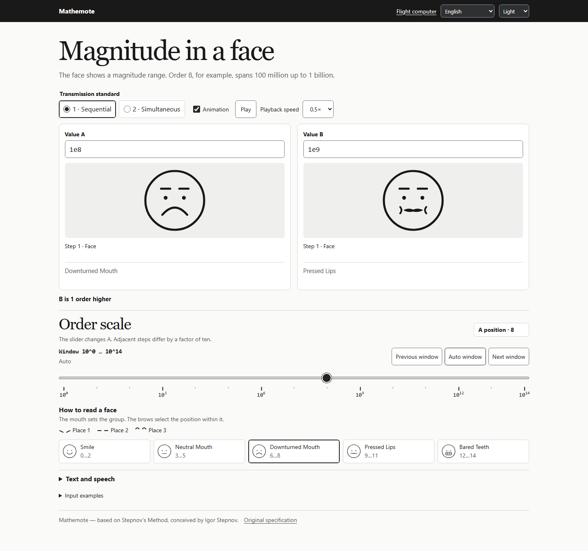

# Mathemote

**An implementation of Stepnov's Method · v1.0.0**  
Original concept and methodology: Igor Stepnov.

Stepnov's Method is a way of representing numeric magnitude through facial expressions. Mathemote is its software implementation and facial notation. The mouth encodes a group of three decimal orders, and the eyebrows identify one of those orders. The original notation stays visible. The design is a hypothesis about readability and is awaiting volunteer evaluation.



## Run locally

If you have an archive, extract the whole folder so the demo, examples and documentation stay together. Open [index.html](index.html) in a current browser with JavaScript enabled. The demo runs offline without installation, a build step or a server.

### Try it in two minutes

1. Enter `2500` in A. Its decimal order is **3** because it is at least 1,000 and less than 10,000. In the initial window, **Neutral Mouth** identifies group 3–5 and **Furrowed Brows** select its first position. The face identifies the interval, and the input field still shows the exact number. Moving the slider writes the power of ten at the selected order. For example, selecting order 4 writes `1e4`.
2. Enter `1e1000` in A. **Auto window** moves to `10^990 … 10^1004` and positions the thumb at **10**. The initial reference B moves from `1e9` to `1e999`, keeping its position **9**. Editing B leaves the shared window in place.
3. Select **Next window** or **Previous window**. The window moves by 15 orders and A jumps to its first tick. If B is a decimal or scientific number within the old window, it moves by the same number of orders, keeping its sign and significant digits. Other B inputs stay as typed. Select **Auto window** and enter `0.01` in A to see a window of negative orders.

The comparison line shows how far apart the orders are. Try `9.99e8` in A and `1e9` in B. Their orders are 8 and 9, and their values are only about 0.1% apart. Enter decimals with a dot, such as `0.01`. For other formats, open **Input examples** below the scale.

### Playback and accessibility

The main demo starts in **1 · Sequential** at **0.5×**. With animation on, playback repeats from page load. It restarts after you release the slider or confirm a typed value. Use **Play** to restart both cards. **Neutral Brows** take five seconds in every cycle, at any speed. Playback speed is directly available on desktop and under **Playback settings** on narrow screens.

In **2 · Simultaneous**, the mouth and active brows relax and return to the selected expression in a continuous loop. Use the speed control to change the cycle duration, or turn off **Animation** to hold the selected expression. A system preference for reduced motion turns animation off by default.

Open **Text and speech** for the exact source and a selectable description. **Read aloud** reads the entire text using a local system voice for the selected language. Choose [Use case](examples/space-navigation.html) in the top navigation to open the flight computer. It compares absolute values in Magnitude and shows the time-to-limit ratio in the experimental Mission mode. Both demos work from local files.

The header offers English, Russian, Spanish, French, German, Brazilian Portuguese, Simplified Chinese, Japanese, Arabic (RTL) and Hindi, plus Light, Dark and System themes. It uses the browser’s preferred language or English when there is no match. System is the default theme.

## Develop and test

From the project folder, run the library tests with Node.js 22 or later.

```sh
npm test
```

On Windows with Microsoft Edge installed, run `./test/slider-browser.ps1` in PowerShell 7 for the browser checks.

To try the library, run `node` from the same folder and paste this example. Pass exact values as strings or BigInt.

```js
const { classify, describe, serialize } = require(".");

const result = classify("  −9.99e8  ", 2);
console.log(result.original);         // "  −9.99e8  "
console.log(result.magnitude_order);  // "8"
console.log(result.face_id);          // "F3"
console.log(result.brow_id);          // "B2"
console.log(describe(result));        // Negative. Downturned Mouth. Raised Brows. Decimal order 8.
console.log(serialize(result));       // Stable JSON for the result
console.log(classify("1e1000").scale_start);        // "990"
console.log(classify("1e1000").scale_position);     // 10
console.log(classify("1e1000", 2, "0").status);     // "out_of_window"
```

See the [implementation specification](docs/specification.md#input-and-api) for input grammar, returned fields, calculation limits and browser integration.

## Documentation

- [Русскоязычное описание](README.ru.md)
- [About the method](about.html) for an introduction, three examples and links to both demos.
- [Original Specification](docs/STEPNOV-METHOD-ORIGINAL-SPECIFICATION.md) for the rules and vocabulary of the method.
- [Implementation specification](docs/specification.md) for how Mathemote computes, displays and reads the result.
- [Volunteer pilot and anonymous recording sheet](docs/readability-pilot.md)
- [Verification results and screenshots](docs/verification.md)
- [Release checklist and GitHub/Zenodo materials](docs/release.md) for author acceptance and publication.
- [Changelog](CHANGELOG.md), [attribution](AUTHORS.md) and [project origin](docs/PROJECT-ORIGIN.md)

## Licensing and citation

Software uses [Apache License 2.0](LICENSE). Original project documentation and visual material use [CC BY 4.0](https://creativecommons.org/licenses/by/4.0/). [Licensing scope](docs/LICENSING.md) · [NOTICE](NOTICE).

Cite Igor Stepnov's [original specification](docs/STEPNOV-METHOD-ORIGINAL-SPECIFICATION.md) for the method and his Mathemote release for the implementation. The citation file distinguishes the two records. [CITATION.cff](CITATION.cff) · [Related research](docs/PRIOR-ART.md).
